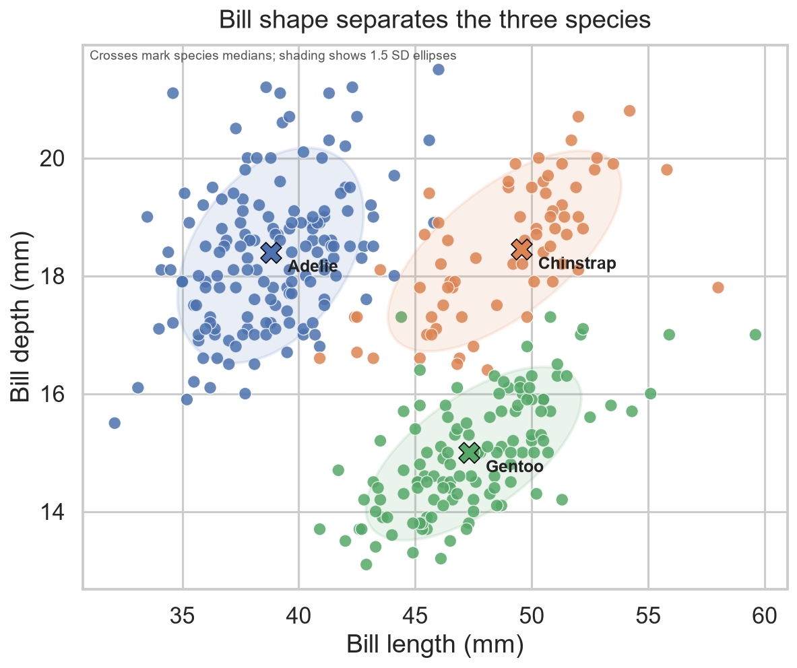
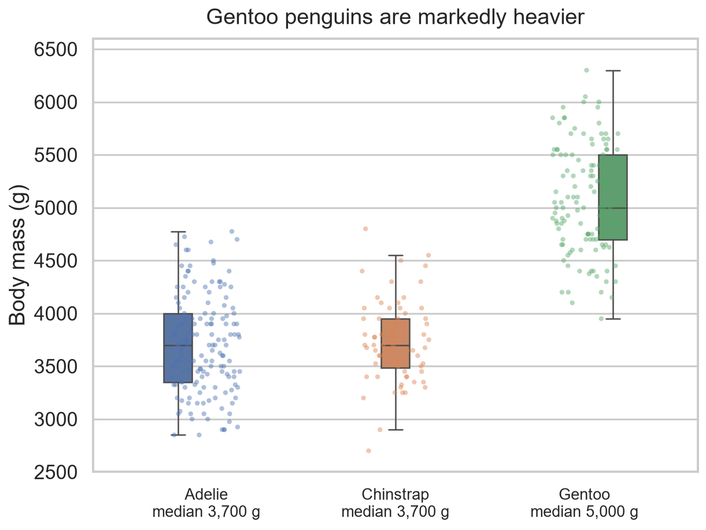
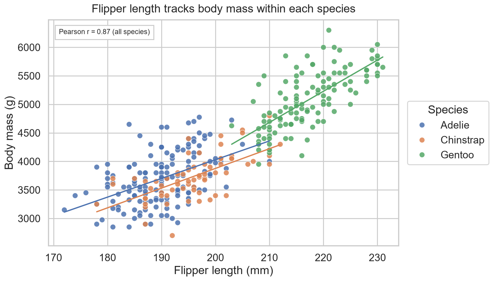

# Penguin Morphology: Can Bill Shape and Body Mass Separate Species?

A compact, reproducible exploratory data analysis of the Palmer Penguins
dataset. The project asks whether simple, easy-to-measure morphological
traits can distinguish the three penguin species, and where their
measurements still overlap.

## Research question

**Do bill dimensions and body mass separate Adelie, Chinstrap and Gentoo
penguins, and how much overlap remains between Adelie and Chinstrap?**

The question matters because field identification often relies on a small
number of body measurements. Understanding which measurements carry the
most separating information shows how far simple descriptive statistics
can go before a formal classifier is needed.

## Dataset and permissions

- **Dataset:** Palmer Penguins (Horst, Hill and Gorman, 2020), a widely used
  teaching dataset of penguin measurements collected at three islands in
  the Palmer Archipelago, Antarctica.
- **Source:** the canonical project is
  [allisonhorst.github.io/palmerpenguins](https://allisonhorst.github.io/palmerpenguins/).
  This repository includes a local copy (`penguins.csv`) obtained from the
  copy distributed with the seaborn example datasets, so the analysis runs
  offline and stays reproducible.
- **Size:** 344 rows and 7 columns. Two rows with missing measurements are
  dropped, leaving **342 complete records**: Adelie 151, Chinstrap 68,
  Gentoo 123.
- **Usage permission:** the Palmer Penguins data are released under
  **CC0 1.0 Universal (public domain dedication)**, so redistribution and
  reuse are permitted. No personal or sensitive data is included.

## Methods and tools

- **Language and tools:** Python 3.13, pandas 3.0, NumPy, matplotlib and
  seaborn. All figures are generated by `analysis.py` with a fixed style.
- **Cleaning:** rows missing bill length, bill depth, flipper length or body
  mass are removed; species is stored as an ordered categorical variable.
- **Descriptive analysis:** median bill length, bill depth, flipper length
  and body mass per species (`summary_stats.csv`).
- **Separation check:** a leave-one-out nearest-centroid classifier using
  only standardised bill length and bill depth. Each penguin is classified
  against centroids computed from the other 341 birds, which avoids
  reporting an optimistic in-sample score.
- **Association check:** Pearson correlation between flipper length and body
  mass, plus per-species linear fits.

## Key findings

1. **Gentoo penguins are much heavier.** Median body mass is **5,000 g** for
   Gentoo, compared with **3,700 g** for both Adelie and Chinstrap, a gap of
   roughly 35%.
2. **Bill length separates Adelie from Chinstrap.** Adelie bill length spans
   32.1-46.0 mm (median 38.8 mm), while Chinstrap spans 40.9-58.0 mm
   (median 49.6 mm). The ranges touch only at the edges, so most birds can be
   told apart on length alone.
3. **Bill depth separates Gentoo from the other two.** Gentoo has a
   shallower bill (median **15.0 mm**) than both Adelie and Chinstrap
   (both **18.4 mm**).
4. **Bill shape is highly informative.** The leave-one-out nearest-centroid
   classifier reaches **93.6% accuracy** using only bill length and depth,
   despite the three classes being imbalanced.
5. **Flipper length tracks body mass.** The overall Pearson correlation is
   **r = 0.87**, and the positive slope holds within each species, so
   flipper length is a useful proxy when a scale is unavailable.

## Limitation

This is an observational analysis of 342 birds from three islands, with
unequal group sizes (151 Adelie, 68 Chinstrap, 123 Gentoo). The nearest-
centroid score describes separation **within this sample**; it is not a
validated identification model. The analysis also ignores sex and island,
both of which are associated with size, and the two dropped rows mean the
sample is slightly incomplete. Extending the work with a held-out test set
and a model that controls for sex and island would give a fairer estimate
of how well these measurements generalise to new colonies.

## Figures

### 1. Bill length versus bill depth



Crosses mark species medians and shaded regions show 1.5 SD covariance
ellipses. Gentoo sits apart on bill depth; Adelie and Chinstrap overlap on
depth but separate on length.

### 2. Body mass by species



Boxes show the interquartile range and median, with individual birds
overlaid. Gentoo is shifted well above the other two species.

### 3. Flipper length versus body mass



Per-species least-squares lines are shown. The strong positive association
(r = 0.87) holds inside each species, not only across the pooled sample.

## Repository contents

| File | Purpose |
| --- | --- |
| `analysis.py` | Full analysis: cleaning, summary statistics, figures, classifier check |
| `penguins.csv` | Local copy of the CC0 Palmer Penguins data |
| `requirements.txt` | Python dependencies |
| `summary_stats.csv` | Generated median measurements per species |
| `fig_*.png` | Generated figures used in this README and the portfolio site |

## Reproducing the analysis

```bash
git clone https://github.com/kai117799/data-science-project.git
cd data-science-project

python -m venv .venv
# Windows: .venv\Scripts\activate
# macOS/Linux: source .venv/bin/activate
pip install -r requirements.txt

python analysis.py
```

The script prints the summary table and key findings, then writes
`summary_stats.csv` and the three figures to the repository root. It needs
no network access because the dataset is included.

## Author

**Liang Hanquan** - MSc Data Science, University of Macau.
Portfolio: [kai117799.github.io/data-science-portfolio](https://kai117799.github.io/data-science-portfolio/)

Dataset: Palmer Penguins, CC0 1.0. Analysis code is shared for learning and
reproduction.
